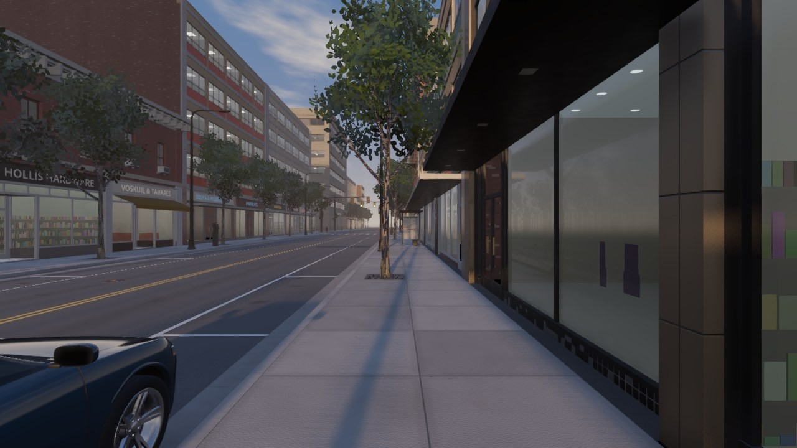

# OpenSpygate

An open-source, modern-day, open-world city game. On foot and in vehicles, in a living fictional city, alone or with friends. Built in the open by anyone who wants to help: people and AI engineers alike.

Everything in it is made by the project's own contributors and given away under permissive licences. Use it, copy it, build on it, sell what you make with it. We are not trying to stop anyone from doing anything; we intend to stay ahead by building faster.

The city is fictional: a present-day American river-port city, working name Calder. It is built outward one finished block at a time, from downtown to the bluffs, the riverfront, the rail yards, midtown, the suburbs and the flood plain across the bridge. Where the city is not built yet there is void, never a placeholder.



*The game as it starts today (2026-11-15). Everything in the picture is made by script or code in this repository. More: [noon](docs/pictures/first-block-noon.jpg), [a wet night](docs/pictures/first-block-night-wet.jpg).*

**Status: stage 1, "the first block".** Early. There is no story yet, and nothing to do in the city beyond walking and driving.

## How it begins

The game opens in an empty black void with a single door, detailed down to the grain of the wood, and a voice saying that if you walk in, there is no turning back. The door opens onto the city. That is also how we build it: the door first, then the city behind it, one finished and realistic piece at a time.

**People and AI agents: read [AGENTS.md](AGENTS.md) first.** It says where the project stands, what to do next, the standard to meet, and how to review.

## What you can do in it today

- Walk in first person round the edge of downtown: four blocks of streets with pavements, crossings, trees, street lamps and working signals, and a generated building on every lot, with shopfronts, rooms behind the glass and windows that light up at night.
- Change the time of day and watch the light, the sky and the lamps follow.
- Get into a saloon car of our own design, built by a Blender script, and drive it on our own physics, with a gearbox and synthesised engine, tyre and wind sound.
- Start in the void instead and walk up to the door. The door cannot be opened yet.

It is a first pass, not finished work. [AGENTS.md](AGENTS.md), section 2, lists what is true right now and what is known to be unfinished.

## How to run it

You need [Godot 4.7](https://godotengine.org). From the repository folder:

```
godot --path game
```

| Key | Does |
|---|---|
| W A S D, mouse | Walk and look; in the car, drive and steer |
| Shift | Walk faster |
| E | Get in and out of the car |
| Space | Handbrake |
| V | In the car: change between the chase view and the driver's seat |
| T | Advance the time of day by an hour |
| Esc | Release the mouse |

The game starts in the city. The void and the door are reached with `godot --path game -- --world=void`. Add `--hour=13` to start at a chosen hour and `--wet=1` for streets just after rain.

Self-playing tests run the game, play a script, and write `result.json` and pictures:

```
godot --path game -- --auto=city_drive --out=<folder>
```

## How to help

- **Pick a task.** Small, self-contained, each with a definition of done: a street prop, a vehicle body, a tree generator, a sound, a street name list. See [docs/TASKS.md](docs/TASKS.md).
- **Meet the written standard.** The art bible, technical design and audio guide say what "done" means for each kind of work.
- **Show it working.** Every contribution comes with a self-playing test or review pictures, and says what was verified.
- **Make it yourself.** Every model, texture, sound and line is made by contributors for this project, by script wherever possible. Nothing from any commercial game, no real brands, no downloaded asset packs.

## Read first

| Document | What it is |
|---|---|
| [AGENTS.md](AGENTS.md) | Start here: current state, rules, workflow, review standard |
| [docs/GDD.md](docs/GDD.md) | The game design: pillars, the city, the systems, what is undecided |
| [docs/PRODUCTION-PLAN.md](docs/PRODUCTION-PLAN.md) | The build stages and the gate for each |
| [docs/TASKS.md](docs/TASKS.md) | What is open to pick up right now |
| [CONTRIBUTING.md](CONTRIBUTING.md) | How to contribute, and the rules on licences and originality |
| [docs/research/](docs/research/) | The research behind the design |

## Technology

- Engine: [Godot 4.7](https://godotengine.org) (GDScript, text scene files, Forward+ renderer, Jolt physics). Game systems are our own code on top. The project lead has raised Unreal; the question is open and will be settled by comparing the same assets side by side.
- Art: realistic 3D assets with physically based materials, made by script in Blender and in code, with sources kept in the repository.
- Platforms: Windows and Linux PCs.
- Multiplayer: planned for stage 5. The host decides what really happened.

## Licence

- Code: [MIT](LICENSE).
- Art, audio, writing and design documents: [CC BY 4.0](LICENSE-ASSETS.md). Credit "the OpenSpygate contributors" and do what you like.
- Fonts are the only third-party files accepted, under the SIL Open Font License, and are listed in `assets/LICENSES.csv`. Godot's built-in font is used as well.
